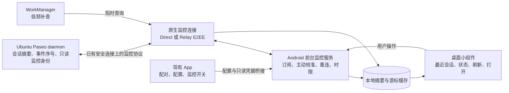

# Android 桌面实时会话小组件开发计划

日期：2026-10-17

源码基线：`custom/public`，`c18eef42dffd6ae621247ca06f1c98fee323a1bd`

状态：方案评审；本次只编写计划，未实现功能、修改服务端部署或构建 APK。

## 1. 目标与已确认的使用方式

用户希望在 Android 桌面查看最近的 Paseo 会话，并在切到其他 App、锁屏后继续接近实时地获得状态变化。用户接受：主动开启监控期间，系统通知区域显示一条持续通知，提供监控状态和停止按钮。

推荐实现：**在现有 Paseo APK 内增加原生桌面小组件和由用户主动启动的原生前台监控服务；服务通过现有连接体系订阅服务器会话状态，并定期主动查询校准。** 主链路独立于 Expo Push。低频后台任务负责监控停止后的状态补查，不承担实时性目标。

交付分为两个等级：

- 实时监控：用户开启，持续通知可见，保持轻量订阅；适用于用户正在等待任务结果的时段。
- 普通看板：不运行前台监控服务，显示缓存、允许点击刷新，按系统允许的时间执行低频更新。

第一版支持单个小组件选择一台服务器，展示最近 3 个根会话，允许固定其中一个会话。同一服务器的多个小组件共享监控连接。跨服务器聚合、完整聊天内容和直接批准权限请求安排在后续版本。

## 2. 必须先验证的 Android 边界

### 2.1 锁屏实时不能只靠桌面小组件本身

`updatePeriodMillis` 的周期下限为 30 分钟；WorkManager 周期任务下限为 15 分钟，且可能延迟。它们适合补查，不能用于每几秒刷新一次。[小组件更新机制](https://developer.android.com/develop/ui/views/appwidgets/advanced)、[周期任务限制](https://developer.android.com/develop/background-work/background-tasks/persistent/getting-started/define-work)。

前台服务会显示持续通知，启动、类型声明及后台启动受 Android 限制。由用户点击 App 或小组件中的“开始监控”触发启动；具体启动入口在 P0 验证。[前台服务](https://developer.android.com/develop/background-work/services/fgs)、[后台启动限制](https://developer.android.com/develop/background-work/services/fgs/restrictions-bg-start)。

### 2.2 前台服务也不是无限时长保证

当前依赖的 React Native Android SDK 默认配置是 target/compile SDK 36，最终以实际 APK manifest 为准。若使用 `dataSync`，Android 15 起对其后台运行施加同类服务合计 24 小时内 6 小时额度；应用回到前台会重置计时。更换服务实例不能绕过额度。必须实现 `onTimeout`，在结束前持久化状态并及时停止。[官方时限说明](https://developer.android.com/develop/background-work/services/fgs/timeout)。

P0 必须确定监控工作的正确前台服务类型及理由。`dataSync` 作为初始候选，原型按其额度进行设计；如长期状态观察不符合该类型，则需重新评估类型与产品范围。不能把媒体、定位或 `specialUse` 当作通用保活开关。若未来发布 Google Play，另行核对服务类型声明要求。

产品初始提供 30/60/120 分钟监控时段，默认 60 分钟，可由用户延长；同时受系统剩余额度约束。模块记录自身运行历史作为额度估计，以系统回调为准，不假设存在可读取精确系统剩余额度的 API。暂不承诺“全天锁屏无人操作、始终秒级到达”。

### 2.3 Doze、厂商省电与网络可达性需要分开验证

Doze 会限制网络与调度；前台服务不能简单等同于所有限制均已解除。用户允许后台活动、加入电池优化豁免后，网络行为仍需在实际设备上测试；豁免也不应视为取消前台服务时限。[Doze 行为与豁免](https://developer.android.com/training/monitoring-device-state/doze-standby)。

目标设备型号、Android/ColorOS 版本、现有后台限制设置以及 Ubuntu 连接方式尚待实施阶段记录。普通安装使用不依赖 root、Shizuku 或日常连接 ADB；ADB 只用于开发验证。

用户强行停止应用后，不承诺自动复活。重启设备后可恢复缓存和系统允许的后台补查；实时服务通过用户再次操作启动，不依赖开机自动启动 `dataSync` 服务。

## 3. 当前源码已经具备什么

| 能力 | 源码位置 | 对本项目的意义 |
| --- | --- | --- |
| 会话查询与订阅 | `packages/client/src/index.ts` 的 `agents.list`、`daemon-client.ts` 的 `fetchAgents` / `observeAgents` | 已有会话目录能力，基础原型无需先新增 HTTP API |
| 列表状态与关注原因 | `packages/protocol/src/messages.ts` 的 `AgentListItemPayloadSchema` | 已有 `status`、`lastUserMessageAt`、`updatedAt`、`requiresAttention`、`attentionReason`、`attentionTimestamp` |
| 状态语义 | `packages/protocol/src/agent-lifecycle.ts`、`docs/agent-lifecycle.md` | 原始状态为 initializing / idle / running / error / closed；idle 不必然表示刚完成 |
| 主机配置与连接 | `packages/app/src/types/host-connection.ts`、`runtime/host-runtime.ts` | 已有 directTcp 与 relay 资料、服务器标识、密码等配置 |
| Relay 加密 | `packages/client/src/daemon-client-relay-e2ee-transport.ts`、`packages/relay/src/crypto.ts` / `encrypted-channel.ts` | Relay 需要端到端握手和 NaCl 兼容加密，不能直接改成普通 HTTP 轮询 |
| 前台活跃状态 | `packages/app/src/hooks/use-client-activity.ts`、服务端 `agent-attention-policy.ts` | 监控连接不能被误认为用户正在看会话，避免改变已有提醒行为 |
| 原生扩展方式 | `packages/app/modules/`、`app.config.js`、`docs/android.md` | 现有 Expo 项目可加入本地原生模块与配置插件 |
| 导航 | `packages/protocol/src/agent-deep-link.ts`、App 的 `utils/host-routes.ts` | 点击小组件可打开准确的服务器和会话 |

因此，服务端开发重点是**监控身份、轻量摘要、可靠的完成标识和断线补齐**，而非重写整个会话查询系统。此前提到的 `fetch_recent_provider_sessions` 用于查找可导入的 provider 会话，不作为本功能数据入口。

当前入口使用 Expo 54 / React Native 0.81.5。已有 `HeadlessJsTaskService` 实现启动任务时获取 partial wake lock，任务结束/服务销毁后释放；不宜直接以一个永不完成的 Headless JS 任务承载监控。实时连接推荐由 Kotlin 原生层负责，JS 负责设置与配置同步。复用 JS 通信引擎只在 P0 实测证明其运行和耗电合格时考虑。

## 4. 推荐架构

### 4.1 Android 原生模块

拟新增 `packages/app/modules/paseo-widget/`，包含：

- Jetpack Glance 小组件、配置 Activity、点击事件及尺寸/主题适配。
- `SessionMonitorService`：前台服务，管理一次用户发起的监控时段。
- `MonitorConnectionManager`：每台选中服务器至多一个原生监控连接；服务与补查任务共享连接协调器。
- `DirectMonitorTransport`、`RelayMonitorTransport`：连接、认证、协议编解码与加密。
- `WidgetRepository`：本地摘要、配置、游标及事件去重；建议用 Room 存摘要/事件，用 DataStore 存轻量设置。
- `MonitorSyncWorker`：普通看板模式的短时网络补查。
- Expo 模块桥接：App 同步服务器配置、申请/撤销监控凭据、读取监控状态。

原生代码、manifest/receiver/service/provider 声明和资源通过模块与 Expo config plugin 管理。必须验证 `expo prebuild --clean` 后仍完整，不能只改生成的 `packages/app/android/`。

Native Widget 从本地缓存渲染；App UI 不运行时，服务仍能写缓存和更新小组件。前台 App 的完整会话连接与监控连接可以各有一个，但监控连接不订阅聊天全文、终端输出或文件内容。

### 4.2 连接与认证

第一版沿用当前 direct/relay 拓扑，不新增需要用户暴露到公网的 HTTP 端口。

- Direct：使用已有端点与 TLS 配置；密码/凭据只进入既有认证阶段。
- Relay：复用 wire 格式及公钥信任关系；当前加密使用 Curve25519、XSalsa20-Poly1305、24-byte nonce。选择兼容且维护中的原生密码库，使用跨语言测试向量验证，不自行设计加密协议。
- Relay 的明文 upgrade/握手前置阶段不携带主机密码；应用认证只在加密通道建立后发送。
- 主机配置由已配对的 App 同步到模块；不额外要求用户复制整条配对链接到桌面小组件。
- 原生侧优先保存服务器签发的只读监控凭据，并用 Android Keystore 支持的方式加密存储。移除主机或关闭授权时立即撤销并清理对应资料。

不假定现有 AsyncStorage 配置已加密，也不把整个主机注册表复制进 widget extras、通知 PendingIntent 或日志。配置迁移仅覆盖本功能需要的最少信息。

### 4.3 服务端监控能力

新增独立 feature capability，例如 `server_info.features.widgetMonitoring`，在连接边界一次判断。旧服务端显示“请更新服务器以使用实时小组件”，遵守仓库兼容规范，不把新特性分散模拟在多个旧 RPC 上。

现有会话目录查询/订阅用于 P0 验证及实现复用。正式版设计一层监控摘要协议，拟使用 `monitoring.status.get.request`、`monitoring.status.observe.request` 及对应响应/事件；最终名称遵循仓库 RPC 命名约定。

需要的服务端工作：

1. **只读身份**：由已认证 App 创建可撤销的监控凭据，限制到服务器允许的会话摘要/事件。认证和权限边界在服务端落实，不能仅靠客户端“不发送写请求”。
2. **非交互来源**：服务器记录连接用途；监控来源不参加“用户正聚焦某会话”的判断，不清除未读/关注状态，不成为前台站内提醒接收者。
3. **摘要查询/订阅**：返回最近会话及正在监控会话的必要字段；沿用已有目录观察基础，限制批量、排序及更新频率。
4. **权威事件标识**：每轮执行有稳定 run/turn 标识，每次完成、失败、取消或等待授权有明确原因和唯一事件 ID。不能将所有 `running → idle` 都推断为成功完成。取消等新增语义放入能力协商后的监控消息，不直接改变旧通知消息既有枚举合同。
5. **断线恢复**：快照带服务器代次和游标；有限事件历史支持短时回放。游标过期或服务器代次变化时明确要求快照重同步。
6. **持久化一致性**：完成记录与会话摘要使用一致的提交顺序，重启可恢复并去重。不能先发事件、崩溃后完全丢失该次完成事实。

建议摘要字段：`serverId`、`agentId`、标题、provider、原始 lifecycle 状态、关注原因、最近用户消息时间、状态变化时间、当前/最近 turn 标识、终态事件 ID、归档信息。项目标签只在现有可授权信息可得时加入。聊天正文默认不发送到小组件。

建议初始范围：最近 3 条用于显示，最多追踪 20 个选中服务器上的活跃根会话；完成事件保留最近 24 小时、最多 1000 条，均作为可调上限。若完整事件历史不能恢复，应显示已恢复当前状态，而不是伪造期间发生的全部提醒。

## 5. 小组件交互与状态规则

### 5.1 展示与操作

第一版提供可调整大小的列表式小组件：小尺寸显示主会话，大尺寸显示 3 条。内容包括服务器名、会话标题、状态文字/图标和最近成功同步时间。

操作入口：打开准确会话、手动刷新、开始/暂停监控、配置服务器与固定会话。开始监控由原生配置/控制界面完成授权检查；不能在不明原因下反复弹出主聊天页面。

支持日间/夜间模式，沿用已设计的新图标。状态同时用文字和图形表达，适配系统字号和长中文标题。运行状态不以逐帧动画或每秒重绘维持。

### 5.2 “最近会话”的定义

- 候选来自未归档根会话，默认排除带 `paseo.parent-agent-id` 的子会话。
- 近期性优先参考最近用户交互/执行活动时间，不单纯以可能受重命名影响的 `updatedAt` 判断。
- 显示优先级：固定会话、需要处理的会话、运行中的会话、最近活动的会话；相同优先级按活动时间及稳定 ID 排序。
- 当前展示的会话刚完成时保留其完成状态，避免立即被另一条会话替换；首版保留窗口建议 5 分钟。
- 正在追踪的会话即使暂时不在可见 3 条中，也要保存其完成事实。归档/删除、固定会话不存在等情况有明确占位和切换行为。

### 5.3 状态语义

| 数据 | 展示行为 |
| --- | --- |
| initializing | 正在启动 |
| running | 执行中 |
| permission attention | 等待你授权；可能与 running 并存，作为展示优先状态 |
| finished event | 本轮已完成；展示完成时间 |
| error event / error state | 执行失败，点击查看 |
| canceled event | 已停止/已取消，不标为成功完成 |
| idle 无完成证据 | 等待输入 |
| closed | 会话未运行，不标为刚完成 |
| 网络断开 / 信息过期 | 保留最后已知状态，同时标记离线/更新于某时 |

连接健康与会话活动是两个维度。会话半小时没有变化、但心跳正常时仍可在线；缓存中的 running 在连接已断开时不能显示成毫无保留的实时执行中。

## 6. 调度、重连、耗电与提醒

### 6.1 主动监控时

- 首次连接拉取快照，随后订阅差量。开始、完成、失败和等待授权等状态立即处理。
- 每 60 秒主动校准摘要，检测订阅遗漏；请求合并，避免与重连快照重复。
- 保活复用协议要求，先测量 relay 自带心跳流量，再决定上层心跳，避免双重高频 ping。
- 小组件同一秒的多次变更合并提交，目标最多每秒一次状态更新；完成/错误优先提交。
- 新事件先写缓存，再更新 Widget。无数据变化时不重复写库或全量刷新。
- 用单调时钟判断连接新鲜度、退避与会话时限；服务器时间用于展示事件时间，顺序以代次/序号为准。

重连采用带随机抖动的退避，例如 1、2、5、10、30、60 秒；网络恢复可触发一次立即尝试。无网络时停止空转，密码失效/凭据被撤销时停止自动重试并提示处理。

跨 Wi-Fi/移动网络、VPN 切换和服务器重启后，重新认证并恢复快照/游标。恢复期间收到旧事件，不得覆盖新状态。到期、停止、系统超时和移除最后一个关联小组件时统一释放连接、订阅、任务及必要的锁。

### 6.2 普通看板模式

按至少 15 分钟的 WorkManager 周期提交网络约束任务；实际执行时间由系统决定。用户手动刷新优先请求短时同步。共享连接协调器防止 Worker 与前台服务重复拉取。

持续监控采用用户发起的单次时段，不用定时器反复重启服务来规避额度，不通过精确闹钟周期性拉活，也不持有整夜 partial wake lock。

### 6.3 通知与诊断

持续通知至少包含：正在监控的服务器、连接状态、剩余时长/到期时间、停止操作。通知权限未授予或通道被关闭时明确显示当前情况，不让用户误以为一定能收到完成提醒。

小组件状态更新是基本交付；另提供“监控期间本地完成提醒”开关。此开关独立于现有前台聊天提示，仅在用户启用后生效。完成提醒以 `(serverId, agentId, turnId, eventId)` 去重；首次读到历史快照时不刷屏补发旧完成提醒。

若同一设备同时收到原有 Expo Push，尽可能为推送补充相同的可选事件 ID 并共享去重记录。原生自动展示的远程通知未必能在展示前拦截；P0/P4 必须验证这一点。如果无法可靠去重，默认关闭本地完成提醒，仅显示 Widget 状态，或另外设计按设备/监控租约协调推送的协议。不能无期限关闭全局推送，否则监控服务异常退出后会再次漏通知。

诊断页面记录最近连接、服务器事件接收、缓存提交、Widget 更新耗时和失败原因。日志不记录密码、配对链接、完整 token 或聊天正文。

## 7. 分阶段实施与验收门槛

| 阶段 | 主要交付 | 阶段通过条件 | 参考工作量 |
| --- | --- | --- | --- |
| P0：可行性验证 | 明确设备/连接方式；最小原生服务；直连和真实 relay 握手；锁屏与耗电实验；服务类型结论 | 用户主动开启后无聊天页面也可接收状态；锁屏 60 分钟可测；查清断流/超时行为 | 2–4 人日 |
| P1：服务端与协议 | capability、只读监控身份、摘要/观察接口、稳定终态事件、游标和持久化 | 多轮执行、断线、服务器重启后状态与事件正确；监控不影响原有通知策略 | 3–4 人日 |
| P2：Android 监控引擎 | 原生服务、direct/relay、凭据桥接、缓存、网络恢复、超时/停止、短时 Worker | 不依赖 React 页面挂载；同服务器多个 widget 共享连接；停止后资源归零 | 4–6 人日 |
| P3：小组件与配置 | 大小尺寸、主题、会话选择、开始/暂停、刷新、深链接、诊断入口 | 真机桌面可用；日夜/字体变化正常；能打开正确会话 | 2–3 人日 |
| P4：可靠性与发布验证 | 锁屏/省电/网络矩阵、耗电和流量报告、通知去重、回归、APK | 达到下述分场景指标；限制清晰可见；构建/签名/真机结果各自记录 | 3–5 人日 |

完整可用版初估 **14–22 人日**，是单开发者有效工作量而非日历承诺。第三方原生加密依赖、现有设备条件和 relay 互操作会影响范围；P0 后更新估算。P0/P1 的协议设计可以部分并行，P2 必须建立在连接与状态合同已确认的基础上。

### P0 必须给出可评审的结果

1. 记录实际手机系统、target SDK、后台活动/电池优化设置、连接拓扑及服务类型选择。
2. 先用现有会话目录订阅做只读技术原型；生产只读凭据在 P1 完成。原型不持久复制 owner 密码。
3. 在 direct 与真实 relay 下验证认证、加密和状态到达；若日常使用 relay，不能只以直连成功宣布可行。
4. 对比默认省电设置与用户允许后台运行后的效果；记录锁屏延迟、断流、功耗和连接重建。
5. 加速测试服务超时、停止和额度耗尽行为，确认不会崩溃或偷偷续命。
6. 给出“可继续 / 需调整连接实现 / 当前设备无法满足锁屏指标”的结论。如果平台条件无法满足，不把问题留到最后的界面验收。

### 测试范围

服务端协议测试覆盖：完成/失败/取消/等待授权的区分；同一会话连续多轮；更新排序与去重；观察连接不参与用户 presence；只读凭据无法调用写操作；旧客户端/旧服务端协商；事件历史过期；服务器重启与恢复。

Android 测试覆盖：服务主动启动/停止/到期/系统 onTimeout；App 冷启动与前后台切换；撤销凭据；设备锁屏/Doze；网络变化；小组件增删/重配；无通知权限；系统杀进程与用户 force-stop 的区别。relay 密文、binary/text 帧、无效公钥、握手超时、密钥不匹配等通过跨语言互操作测试验证。

UI 验证至少包括浅色/深色、大小字号、长标题、两种尺寸、离线/缓存状态、多实例与正确深链接。AOSP 模拟器结果和实际目标手机结果分别记录。

### 初始体验指标（需 P0 确认可达后冻结）

| 场景 | 目标 |
| --- | --- |
| 服务已连接、网络正常、亮屏切到其他 App | 服务端权威状态提交至目标手机桌面可见变化，P95 ≤ 5 秒 |
| 用户已开启监控、锁屏且后台配置经验证 | 服务端事件至设备缓存 P95 ≤ 10 秒；测试至少 60 分钟，覆盖完成/失败/授权事件 |
| 解锁回到桌面 | 显示锁屏期间已收到的最新状态，目标 ≤ 2 秒；与网络新请求的耗时分开测量 |
| 服务停止或系统阻止实时网络 | 明确显示最后更新时间；不适用上述实时指标 |
| 网络恢复 | 网络可用后 P95 ≤ 10 秒恢复当前状态；历史事件按游标补齐 |
| 同一轮完成事件重发/重连 | 状态幂等；启用本地提醒时，同一事件本地最多提醒一次 |
| 停止或超时 | 服务、连接与唤醒锁及时释放；停止后不再主动维持实时连接 |
| 功耗和流量 | P0 建立“关闭监控 / 空闲监控 / 活跃监控”同条件对照；P4 给出额外耗电、唤醒时长、消息数/字节数；据实决定可接受阈值 |

延迟指标从服务端生成权威状态开始计算，不把模型本身的运行耗时算入。测量同时记录事件到设备、写库、请求 Widget 更新和桌面实际显示四个时间点，区分连接问题与 launcher 刷新延迟。跨设备时间比较校准时钟并记录误差，断网或限制场景单独统计。

功耗在尚无基线时不预先声称“每小时仅消耗某个百分比”；锁屏连续实验至少重复两组，避免用短测试的电池百分比作结论。

## 8. 预计修改位置与兼容策略

| 区域 | 预计修改 |
| --- | --- |
| `packages/protocol/src/` | 监控能力字段、消息 schema、摘要与终态标识；新字段对既有客户端保持可选 |
| `packages/server/src/server/` | 监控来源与认证权限、摘要观察服务、有限事件存储、能力声明；复用 agent manager / registry |
| `packages/client/src/` | 监控 RPC 的 TS 封装、能力判断及测试工具；现有 App 配置/验证可复用 |
| `packages/relay/` | 首选仅增加互操作测试向量和规范说明；不为了小组件改动既有加密 wire 格式 |
| `packages/app/modules/paseo-widget/` | Kotlin/Glance 服务、传输、缓存、Worker、原生配置与 Expo 桥接 |
| `packages/app/plugins/`、`app.config.js` | 可重复生成的原生声明与资源配置 |
| `packages/app/src/` | 监控设置、主机授权/撤销桥接、入口状态、i18n、诊断与导航 |
| `docs/` | 协议、设备测试结果、后台设置指南与使用限制 |

依照 `docs/protocol-compatibility.md`：能力在单个边界判断；新旧客户端通信结构保持兼容；新服务端字段为可选；新功能缺失时直接提示升级主机。协议变更记录为何旧 App 可继续解析，新 App 为何不会向不支持的旧服务端发送新请求。

当前工作区已有本地 `app.config.js` 定制签名/变体、生成终端 bundle 和未跟踪签名插件。实施时先核对并保留这些内容；公共提交只包含本功能需要的源码与配置，不包含凭据或本地签名资料。

## 9. 部署、交付与后续范围

发布顺序：兼容的 daemon 更新 → 验证真实 Ubuntu 运行版本与 capability → 安装新 APK → 配对并授权监控 → 添加 widget → 用户开启一次监控 → 真机验收。

只有 APK 更新而 Ubuntu 仍运行旧 daemon 时，正式监控功能应显示升级提示。推送代码到 GitHub与部署 Ubuntu 是两件事，发布记录分别列出。

交付物包括：协议/接口说明、可评审代码、单测与原生构建结果、目标手机的延迟/锁屏/耗电报告、同签名可升级 APK、版本与 commit、包名、大小、SHA-256、签名校验及安装说明。APK 按用户后续发布要求上传 Google Drive 并回读元数据；不把构建成功当作真实后台链路验证成功。

回退入口：关闭实时监控即可释放资源；服务器撤销监控凭据；保留普通 App 会话访问能力。服务端新增能力应可独立关闭，避免回退必须删除已有会话数据。

后续可选：多服务器聚合、锁屏组件、更多会话/筛选、选择性本地提醒增强、跨设备同步监控配置。全天候锁屏实时需另行评估系统推送或其他可用传输条件，不能通过堆叠周期任务获得保证。

## 10. 实施前仍需确认的事实

- 手机型号、Android/ColorOS 版本及后台限制状态。
- 当前 Ubuntu 运行版本、启动方式，以及手机实际走 direct 还是 relay；不能用本机 Git HEAD 代替部署版本。
- 任务通常持续多久、每天需要监控几个小时，用于确定默认时段和额度展示。
- 具体目标桌面启动器；厂商 launcher 的渲染刷新行为需要实测。

这些信息影响 P0 实验配置，但不阻塞计划评审。已确认的前提是：锁屏/其他 App 场景也希望及时更新；持续通知仅在用户主动开启监控期间显示。
